# Bayesian Recap

## Data Generating Process {.center .recap-slide}

We observe $X \sim p_0$.

::: {.fragment}
$p_0$ is the *data generating process*.
:::

::: {.fragment}
How can we use $X$ to make inferences about $p_0$?
:::

## Bayesian Approach {.center .recap-slide}

Assume $p_0 \in \mathcal{P} = \{p(\cdot \mid \theta) : \theta \in \Theta\}$.

::: {.fragment}
The prior $p(\theta)$ describes our uncertainty before observing $x$.
:::

::: {.fragment}
After observing $X=x$, update by Bayes’ rule.

$$
p(\theta \mid x)
= \frac{p(x \mid \theta)\,p(\theta)}{p(x)}
\propto p(x \mid \theta)\,p(\theta).
$$
:::

## {#from-bayes-to-sbi .inference-slide}

::: {.bayes-line}
[$p(\theta\mid x)$]{#bayes-post} $\propto$ [$p(x\mid\theta)$]{#bayes-like} [$p(\theta)$]{#bayes-prior}
:::

:::::: {.conjugacy .fragment .fade-out fragment-index="2"}
::::: {.fragment fragment-index="0"}
### Conjugacy

::: {.case-intro}
Let $x$ count successes in $n$ independent trials with success probability $\theta$ and a $\operatorname{Beta}(a,b)$ prior.
:::

::: {.example-prior}
[$\displaystyle p(\theta)=\frac{\theta^{a-1}(1-\theta)^{b-1}}{\mathrm{B}(a,b)}$]{#conj-prior}
:::

::: {.example-likelihood}
[$\displaystyle p(x\mid\theta)=\binom{n}{x}\theta^x(1-\theta)^{n-x}$]{#conj-like}
:::

:::::
::::: {.fragment fragment-index="1"}
::: {.example-posterior}
[$\displaystyle p(\theta\mid x)=\frac{\theta^{a+x-1}(1-\theta)^{b+n-x-1}}{\mathrm{B}(a+x,b+n-x)}$]{#conj-post}
:::
:::::
::::::

::::: {.mh .fragment .fade-in-then-out fragment-index="2"}
### Markov-Chain Monte Carlo

::: {.mh-proposal}
Draw $\theta' \sim q(\cdot\mid\theta)$.
:::

::: {.mh-update}
Set $r=$ [[[$p(x\mid\theta')$]{#mh-like} [$p(\theta')$]{#mh-prior} $q(\theta\mid\theta')$]{.numerator} [$p(x\mid\theta)\,p(\theta)\,q(\theta'\mid\theta)$]{.denominator}]{.fraction}.
:::

::: {.mh-decision}
Draw $u\sim\operatorname{Uniform}(0,1)$.

If $u < \min(1,r)$, set $\theta \leftarrow \theta'$.
:::
:::::

::::: {.sbi .fragment fragment-index="3"}
### Simulation-based inference

::: {.case-intro}
Assume we can sample from the prior and the simulator, even when the **likelihood is intractable**.
:::

::: {.example-prior}
[$\theta \sim p(\theta)$]{#sbi-prior}
:::

::: {.example-likelihood}
[$X \sim p(\cdot\mid\theta)$]{#sbi-like}
:::

::: {.simulator-callout}
[we call this the simulator]{#simulator-name}
:::

:::::



# Introduction to Simulation-based Inference

## Epidemiology {#epidemiology .epi-slide}

::: {.epi-questions}
What is the probability of infection after contact with an infectious person?

What is the probability of recovery in one time step?
:::



## Let’s make a simulator {#sir-simulator .epi-slide}

::: {.sir-parameters}
$\theta = (\theta_1, \theta_2)$  
Per time step

~~~{=html}

  <label for="sir-p">Transmission per infectious neighbor</label>
  
<i>θ</i>1 = <output id="sir-p-value" for="sir-p">0.499</output><input id="sir-p" type="range" aria-label="Theta 1, transmission per infectious neighbor" min="0" max="1" step="any" value="0.4989631228474053">

  <label for="sir-q">Recovery per infectious person</label>
  
<i>θ</i>2 = <output id="sir-q-value" for="sir-q">0.265</output><input id="sir-q" type="range" aria-label="Theta 2, recovery per infectious person" min="0" max="1" step="any" value="0.26451491183267895">

~~~
:::

~~~{=html}

  

    <figure><figcaption>Simulated states</figcaption><canvas id="sir-states" role="img"></canvas></figure>
    <figure><figcaption id="sir-visit-caption">Last observation</figcaption><canvas id="sir-visit" role="img"></canvas></figure>
  

  

    <button type="button" id="sir-play">Play</button>
    <button type="button" id="sir-reset">Reset</button>
    <label for="sir-time">Step <output id="sir-clock" for="sir-time">8</output></label>
    <input id="sir-time" type="range" min="0" max="32" step="1" value="8">
  

  
One person per cellSusceptibleInfectiousRecovered

~~~

## Real-world observations {#sir-observations .epi-slide}

We observe the SIR outbreak $x^*$ simulated at $\theta\approx(0.499,0.265)$. Here are the first three of eight visits.

~~~{=html}

  <figure><canvas data-sir-visit="4" role="img"></canvas><figcaption><i>t</i> = 4</figcaption></figure>
  <figure><canvas data-sir-visit="8" role="img"></canvas><figcaption><i>t</i> = 8</figcaption></figure>
  <figure><canvas data-sir-visit="12" role="img"></canvas><figcaption><i>t</i> = 12</figcaption></figure>

~~~

::: {.sir-note}
Red cells were recorded as infectious.
:::

We want to find the posterior $p(\theta \mid x^*)$.

# Neural Methods for SBI

## Conditional density estimation {#conditional-density-estimation .neural-slide data-menu-title="Neural likelihood estimation"}

Generate $\theta \sim p(\theta)$, then $x \sim p(x \mid \theta)$.

Parameterize the conditional density $q$ with a neural network $q_\phi$.

:::: {.cde-flow role="group" aria-label="Simulated data and parameter pairs train a neural conditional density estimator to approximate the likelihood."}



::: {.cde-output}
$q_\phi(x\mid\theta)$
:::
::::

::: {.fragment .cde-approximation fragment-index="0"}
[$q_\phi(x\mid\theta) \approx p(x\mid\theta)$]{.cde-equation} [[$\leftarrow$]{.cde-pointer aria-hidden="true"} [call this **Neural Likelihood Estimation (NLE)**]{.cde-name}]{.cde-annotation}
:::

::: {.fragment .training-loss fragment-index="1"}
Train by minimizing $\mathcal L_{\mathrm{NLE}}(\phi)=\mathbb E_{(x,\theta)\sim p(x,\theta)}\!\left[-\log q_\phi(x\mid\theta)\right]$
:::

::: {.fragment fragment-index="2"}
Run MCMC with target proportional to $q_\phi(x^*\mid\theta)\,p(\theta)$.
:::

## Conditional density estimation {#neural-posterior-estimation .neural-slide data-menu-title="Neural posterior estimation"}

Generate $\theta \sim p(\theta)$, then $x \sim p(x \mid \theta)$.

Parameterize the conditional density $q$ with a neural network $q_\phi$.

:::: {.cde-flow role="group" aria-label="Simulated data and parameter pairs train a neural conditional density estimator."}



::: {.cde-output}
[[$q_\phi(x\mid\theta)$]{.fragment .fade-out fragment-index="0"} [$q_\phi(\theta\mid x)$]{.fragment fragment-index="0"}]{.r-stack}
:::
::::

::: {.cde-approximation}
[[$q_\phi(x\mid\theta) \approx p(x\mid\theta)$]{.fragment .fade-out fragment-index="0"} [$q_\phi(\theta\mid x) \approx p(\theta\mid x)$]{.fragment fragment-index="0"}]{.cde-equation .r-stack} [[$\leftarrow$]{.cde-pointer aria-hidden="true"} [call this [[**~~Neural Likelihood Estimation (NLE)~~**]{.fragment .fade-out fragment-index="0"} [**Neural Posterior Estimation (NPE)**]{.fragment fragment-index="0"}]{.r-stack}]{.cde-name}]{.cde-annotation}
:::

::: {.training-loss}
Train by minimizing [[$\mathcal L_{\mathrm{NLE}}(\phi)=\mathbb E_{(x,\theta)\sim p(x,\theta)}\!\left[-\log q_\phi(x\mid\theta)\right]$]{.fragment .fade-out fragment-index="0"} [$\mathcal L_{\mathrm{NPE}}(\phi)=\mathbb E_{(x,\theta)\sim p(x,\theta)}\!\left[-\log q_\phi(\theta\mid x)\right]$]{.fragment fragment-index="0"}]{.r-stack}
:::

::: {.fragment fragment-index="1"}
Use $q_\phi$ as the approximated posterior.
:::

## Transport maps {#transport-maps .figure-slide .transport-slide}

For every $x$, draw $\eta \sim \mathcal N(0,I)$ and transform it into

$$\theta = T_\phi(\eta; x) \sim q_\phi(\theta \mid x) \approx p(\theta \mid x).$$

The heatmap uses a second outbreak with an eight-step delay before infectiousness.

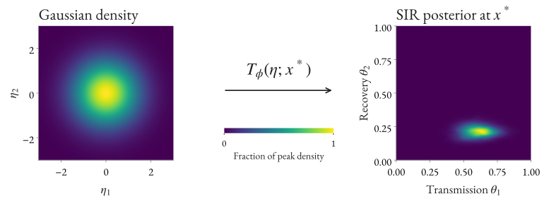

## Normalizing flows {#normalizing-flows .figure-slide .transport-slide}

:::: {.nf-derivation}
For fixed $x$, the [inverse]{.nf-inverse data-word="inverse"} and [Jacobian determinant]{.nf-jacobian data-word="jacobian"} must be tractable since

::: {.fragment .nf-equation}
$q_\phi(\theta \mid x) = \mathcal N\!\bigl($[$T_\phi^{-1}(\theta; x)$]{.nf-inverse data-term="inverse"}$\mid 0,I\bigr)$ [$\displaystyle\left|\det \frac{\partial T_\phi^{-1}(\theta; x)}{\partial \theta}\right|$]{.nf-jacobian data-term="jacobian"}$.$
:::


::::

::: {.fragment .flow-paper-panel}
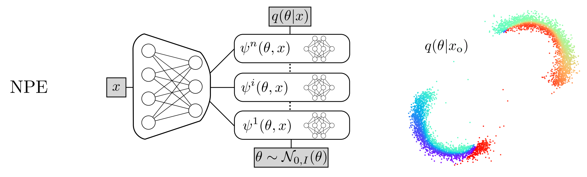

[Dax et al. (2023), Fig. 1, NPE panel](https://arxiv.org/pdf/2305.17161#page=2)
:::

::: {.fragment .flow-takeaway}
**Normalizing flows put a lot of constraints on the architecture of the network.**
:::

::: {.fragment}
Can we develop more flexible architectures for density estimation?
:::

# Research Direction I: Generative Modeling for SBI {#research-direction-i-generative-modeling-for-sbi}

## Flow matching {#flow-matching .figure-slide .transport-slide}

Learn a vector field $v_{t,x}$ whose flow takes samples from $\mathcal N(0,I)$ to the learned posterior $q_\phi(\theta\mid x)$ by minimizing

$$\mathcal L_{\mathrm{FM}}(v)
=\mathbb E_{\theta,x,\eta,t}\!\left[\left\|v_{t,x}(\theta_t)-(\theta-\eta)\right\|^2\right].$$

::: {.flow-paper-panel}
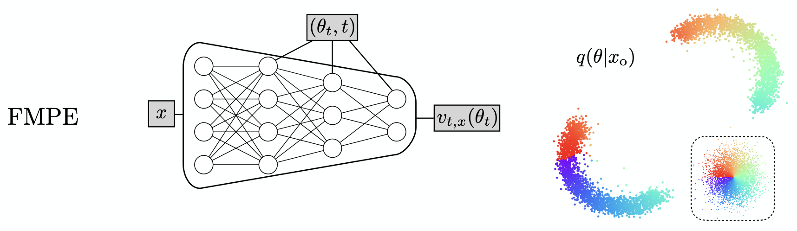

[Dax et al. (2023), Fig. 1, FMPE panel](https://arxiv.org/pdf/2305.17161#page=2)
:::

Flow matching imposes no special architectural constraints on the neural network that parameterizes $v_{t,x}$.

## Score matching {#score-matching .figure-slide .transport-slide}

Add noise to the simulated parameters. Learn the noisy posterior score $s_{t,x}(\theta_t)\approx\nabla_{\theta_t}\log p_t(\theta_t\mid x)$ by minimizing

$$\mathcal L_{\mathrm{SM}}(s)
=\mathbb E_{\theta_0,x,t,\theta_t}\!\left[\left\|s_{t,x}(\theta_t)-\nabla_{\theta_t}\log p_t(\theta_t\mid\theta_0)\right\|^2\right].$$

::: {.flow-paper-panel}
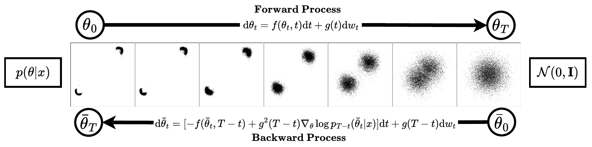

[Sharrock et al. (2024), Fig. 1](https://proceedings.mlr.press/v235/sharrock24a.html)
:::

For fixed $x$, start from Gaussian noise at $t=T$. Use the learned score to run the diffusion back to $t=0$ for an approximate posterior draw.

## Sampling and density evaluation {#flow-sampling-density .figure-slide .transport-slide}

For fixed $x$, numerically integrate the flow-matching ODE $\dot\theta(t)=v_{t,x}(\theta(t))$.

:::: {.flow-operations}
::: {.flow-operation}
**Sampling**

Start at $\theta(0)=\theta_0\sim\mathcal N(0,I)$.

Integrate forward from $t=0$ to $1$.

Return $\theta(1)$ as the posterior draw.
:::

::: {.flow-operation}
**Density evaluation**

Start at $\theta(1)=\theta$.

Integrate backward from $t=1$ to $0$.

$$\begin{aligned}
\log q_\phi(\theta\mid x)
  &= \log \mathcal N(\theta(0)\mid 0,I)\\
  &\quad - \int_0^1 (\operatorname{div} v_{t,x})(\theta(t))\,dt .
\end{aligned}$$
:::
::::

[Dax et al. (2023), *Flow Matching for Scalable Simulation-Based Inference*, Eqs. (2)–(3)](https://arxiv.org/pdf/2305.17161#page=4){.flow-source}

## Flow matching in the SIR example {#sir-flow-matching .figure-slide .transport-slide}

Condition on all eight observed maps $x^*$. Start each draw at $\theta_0=\eta\sim\mathcal N(0,I)$ and follow $\dot\theta_t=v_{t,x^*}(\theta_t)$ to $t=1$.





## {#cosine-posterior .figure-slide .transport-slide data-menu-title="Cosine posterior comparison"}

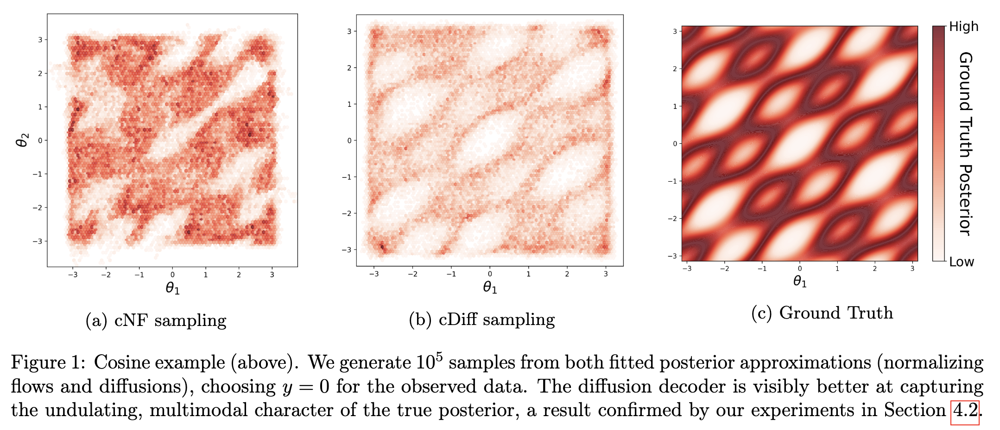

[Chen, Bansal and Scott (2024), Fig. 1](https://arxiv.org/pdf/2410.19105){.flow-source}

## Recent advances {#recent-advances .figure-slide .transport-slide}

**Compositional score modeling** combines scores from conditionally independent observations to sample a shared posterior. [Geffner et al. (2023)](https://proceedings.mlr.press/v202/geffner23a.html){.flow-source}

**Consistency models** generate a posterior draw in one or a few network evaluations. [Schmitt et al. (2024)](https://proceedings.neurips.cc/paper_files/paper/2024/hash/e58026e2b2929108e1bd24cbfa1c8e4b-Abstract-Conference.html){.flow-source}

**Flow matching calibration** uses a small set of observations with known parameters to correct posterior estimates under simulator misspecification. [Ruhlmann et al. (2026)](https://proceedings.mlr.press/v306/ruhlmann26a.html){.flow-source}

# Research Direction II: Summary Statistics {#summary-statistics}

## Why use summary statistics? {#summary-why .figure-slide .summary-why-slide}

$$x\in\mathcal X\subseteq\mathbb R^n,\qquad S:\mathcal X\to\mathbb R^d$$

::: {.summary-reasons}
- **Dimension reduction.** $d<n$
- **Bias and variance.**
:::

~~~{=html}
<figure class="summary-bias-figure">
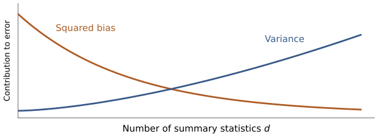
<figcaption>Illustrative curves for a fixed simulation budget.</figcaption>
</figure>
~~~

## What makes a good summary? {#summary-good .figure-slide .summary-good-slide}

$$q_\phi(\theta\mid S(x))\approx p(\theta\mid S(x))\approx p(\theta\mid x)$$

- NPE learns the posterior given $S(x)$.
- A good summary preserves the information about $\theta$ needed for inference.
- If $S$ is sufficient, $p(\theta\mid S(x))=p(\theta\mid x)$.

## No summary statistics {#summary-construction .figure-slide .summary-method-slide}

~~~{=html}

<h3>Raw maps + direct NPE</h3>

Flatten the three maps into 1,728 inputs and pass them straight to the flow.

<svg viewBox="0 0 1287 642" aria-hidden="true">
<rect x="468" y="112" width="311" height="405" rx="9" fill="#ad5d26" fill-opacity=".06" stroke="#ad5d26" stroke-width="6" stroke-dasharray="12 9"/>
<path d="M 483 128 L 764 501 M 764 128 L 483 501" fill="none" stroke="#fff" stroke-width="17"/><path d="M 483 128 L 764 501 M 764 128 L 483 501" fill="none" stroke="#ad5d26" stroke-width="9"/>
</svg>

<a href="https://arxiv.org/pdf/2305.17161#page=2">Dax et al. (2023), Fig. 1, NPE architecture</a>

~~~

## Hand-picked summaries {#summary-handpicked .figure-slide .summary-method-slide}

Let $X=(X_4,X_8,X_{12})$ be the three infection maps.

:::: {.summary-map-pair}
::: {.summary-stat style="--focus:#596674"}

~~~{=html}
<h3>Counts only</h3>
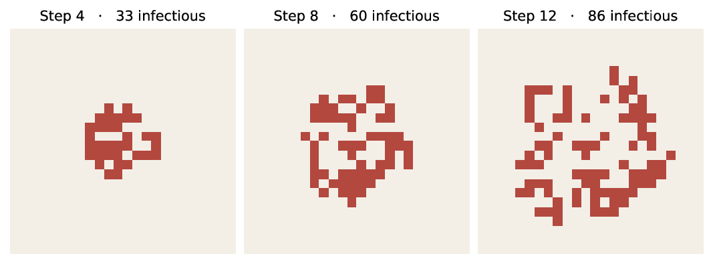
~~~

$C_t$ counts infectious cells at visit $t$.

$$
\begin{aligned}
S(X) &= (C_4,C_8,C_{12}) \\
     &= (33,60,86).
\end{aligned}
$$
:::
::: {.summary-stat style="--focus:#176c61"}

~~~{=html}
<h3>Counts + overlaps</h3>
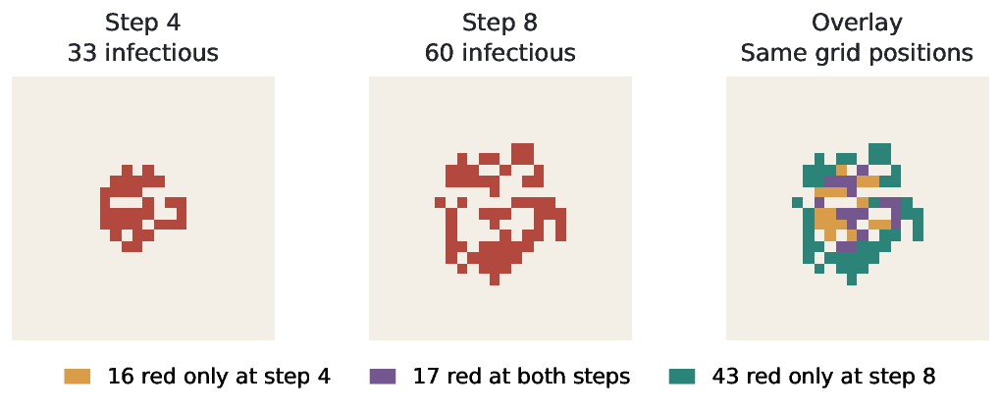
~~~

$O_{t,u}$ counts cells infectious at both visits.

$$
\begin{aligned}
S(X) &= (C_4,C_8,C_{12},O_{4,8},O_{8,12}) \\
     &= (33,60,86,17,25).
\end{aligned}
$$
:::
::::

## Learn end to end {#summary-end-to-end .figure-slide .summary-method-slide}

~~~{=html}

<h3>Raw maps + CNN</h3>

Train the CNN encoder and the flow together. The CNN learns 16 features from the three maps.

<svg viewBox="0 0 1287 642" aria-hidden="true">
<rect x="468" y="112" width="311" height="405" rx="9" fill="#395a89" fill-opacity=".06" stroke="#395a89" stroke-width="6"/>

</svg>

<a href="https://arxiv.org/pdf/2305.17161#page=2">Dax et al. (2023), Fig. 1, NPE architecture</a>

~~~

## Learn separately {#summary-learn-separately .figure-slide .summary-method-slide}

~~~{=html}
<figure class="summary-theorem">
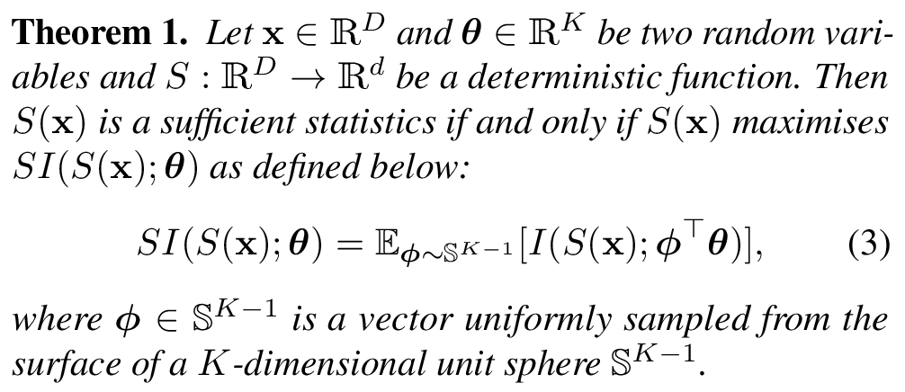
<a class="summary-theorem-source" href="https://proceedings.mlr.press/v202/chen23h/chen23h.pdf#page=3">Chen, Gutmann, and Weller (2023), Theorem 1</a>
</figure>
~~~

## SIR example {#summary-benchmark .figure-slide .summary-result-slide}

~~~{=html}

Three visits with immediate onset · Closer to 50% (chance) is better

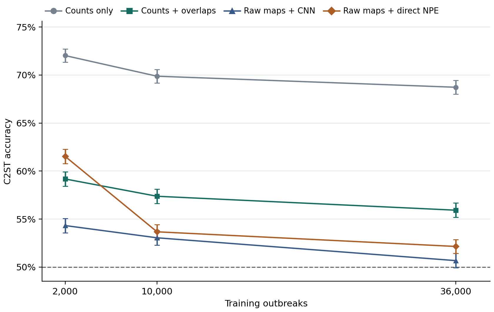

<strong>Counts only</strong>3 counts

<strong>Counts + overlaps</strong>5 summary statistics

<strong>CNN</strong>16 learned features

<strong>Direct NPE</strong>1,728 raw entries

~~~

# Research Direction III: Model Misspecification {#misspecification}

## When the truth lies outside the model {#model-gap .figure-slide}

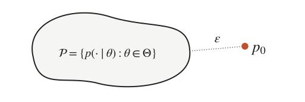

$$\varepsilon = \inf_{\theta\in\Theta}D\!\left[p_0(x):p(x\mid\theta)\right]>0$$

## Introducing misspecification to SIR {#delayed-onset .figure-slide}

~~~{=html}

  <strong>Assumed simulator</strong>
  
S⟶I⟶R

  
=≠

  <strong>Data-generating process</strong>
  
S⟶E<small>eight steps</small>⟶I⟶R

~~~

## Simulating a four-step delay {#delayed-simulator .epi-slide}

~~~{=html}

  

    <figure><figcaption id="delay-state-caption">Simulated states</figcaption><canvas id="delay-states" role="img"></canvas></figure>
    <figure><figcaption id="delay-visit-caption">Last simulated visit</figcaption><canvas id="delay-visit" role="img"></canvas></figure>
  

  

    <button type="button" id="delay-play">Play</button>
    <button type="button" id="delay-reset">Reset</button>
    <label for="delay-time">Step <output id="delay-clock" for="delay-time">8</output></label>
    <input id="delay-time" type="range" min="0" max="16" step="1" value="8">
  

  
One person per cellSusceptibleExposedInfectiousRecovered

~~~



## The effect of misspecification {#biased-posterior .figure-slide}

~~~{=html}
<fieldset class="posterior-view">
  <legend>Parameter range</legend>
  <input id="posterior-detail" name="posterior-range" type="radio" checked><label for="posterior-detail">Zoomed</label>
  <input id="posterior-full" name="posterior-range" type="radio"><label for="posterior-full">Full square</label>
  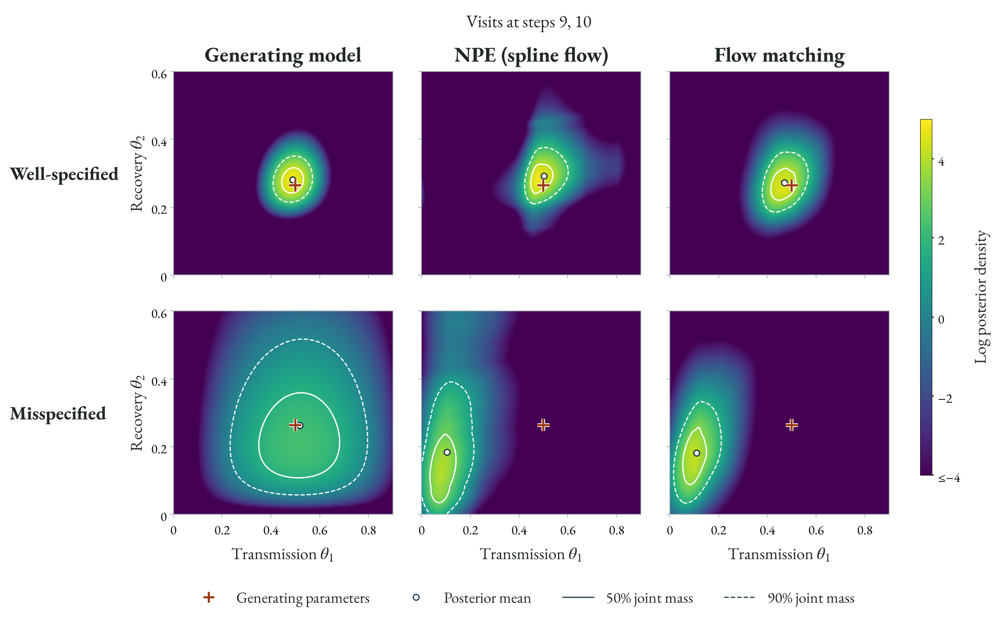
  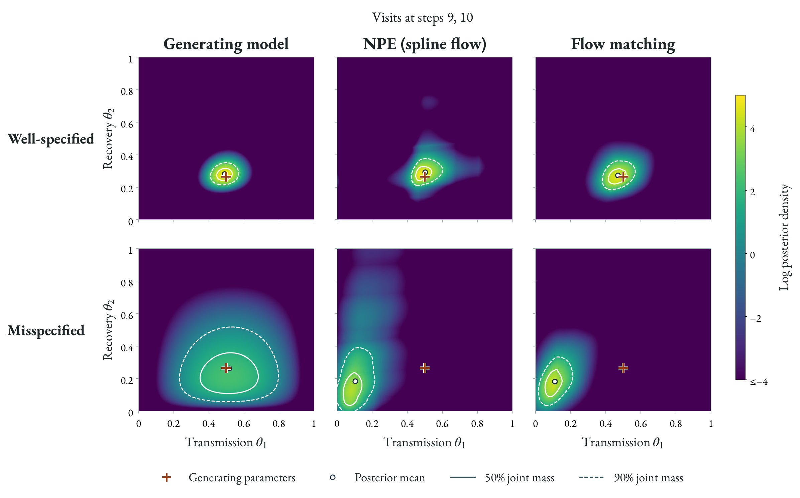
</fieldset>
~~~

## Coverage under delayed onset {#coverage .figure-slide}

For each delay, how often does the fitted region contain the transmission and recovery rates that generated the step-12 map?

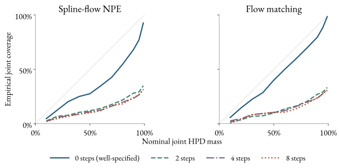

## Dealing with model misspecification {#dealing-with-misspecification .figure-slide .transport-slide}

**Posterior ensembles** average the posterior densities from independently trained networks. [Cannon et al. (2022)](https://arxiv.org/pdf/2209.01845#page=6){.flow-source}

**Regularized summaries** retain information about the parameters while penalizing differences between simulated and observed summaries. [Huang et al. (2023)](https://proceedings.neurips.cc/paper_files/paper/2023/file/16c5b4102a6b6eb061e502ce6736ad8a-Paper-Conference.pdf){.flow-source}

**Discrepancy models** specify how an observation can differ from the simulator output. [Ward et al. (2022)](https://papers.neurips.cc/paper_files/paper/2022/hash/db0eac6747e3631eb91095cd76065611-Abstract-Conference.html){.flow-source}

Does **posterior contraction** still occur under model misspecification, and if so, what does it look like? [Gelman and Shalizi (2013)](https://sites.stat.columbia.edu/gelman/research/published/philosophy.pdf){.flow-source}

# New advances {#new-advances}

## Research Direction IV: Scalable and flexible SBI {#npe-pfn .figure-slide .transport-slide}

**All-in-one SBI** trains one network to sample parameters given data or data given parameters. [Gloeckler et al. (2024)](https://proceedings.mlr.press/v235/gloeckler24a.html){.flow-source}

**NPE-PFN** uses simulated $(\theta,x)$ pairs as context for a pretrained tabular model to estimate the posterior at $x^*$. [Vetter et al. (2025)](https://papers.nips.cc/paper_files/paper/2025/hash/770cabd044c4eacb6dc5924d9a686dce-Abstract-Conference.html){.flow-source}

## Research Direction V: Simulator transparency {#simulator-transparency .figure-slide .transport-slide}

Using the internal states $z$ of the simulator to improve inference

**Mining gold** uses the joint score of $(x,z)$ to train a likelihood estimator. [Brehmer et al. (2020)](https://pmc.ncbi.nlm.nih.gov/articles/PMC7071889/){.flow-source}

**Inference compilation** learns from simulated paths to propose hidden states consistent with the observation. [Le et al. (2017)](https://proceedings.mlr.press/v54/le17a.html){.flow-source}

# Thank you {#thank-you}

Special thanks to Yichen Ji and Prof. Ricardo Baptista
